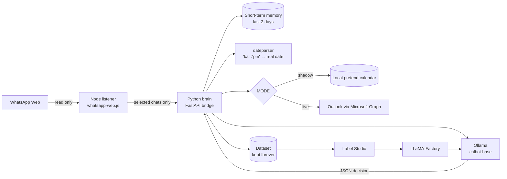

# WhatsApp → Outlook Calendar


-purple)


A bot that reads the WhatsApp groups **you pick** (club, sports, dance...) and keeps your **Outlook calendar** in sync by itself:

- "dance practice tomorrow 6pm at OAT" → **adds** an event
- "practice shifted to 7" → **moves** that event
- "aaj ki practice cancel" → **deletes** it

Everything runs on your laptop. A local model in [Ollama](https://ollama.com) reads the messages, and no chat text goes to any online AI service. Every decision the bot makes is saved as a training example, so you can label them and **fine-tune your own model** with [Label Studio](https://labelstud.io) and [LLaMA-Factory](https://github.com/hiyouga/LLaMA-Factory).

## How it works



1. The **listener** logs in to WhatsApp Web, ignores every chat you didn't select, and forwards new messages to the brain. It never sends messages.
2. A quick **keyword filter** skips chit-chat ("ok", "hahaha") so the model only sees messages that might be about an event.
3. The **model** gets the message, the last 2 days of that group, and the events the bot already created. It answers in JSON: `add / reschedule / cancel / none`, plus the date and time **words copied from the message**.
4. **Python** turns those words into real dates. Small models are bad at calendar arithmetic, so the model never calculates dates itself.
5. The **calendar description** of each event the bot creates holds its source group, the original message and a change history. That makes the calendar the bot's long-term memory, after the 2-day chat memory has been deleted.
6. Every decision goes into the **dataset**, ready for labeling and training.

More detail: [docs/ARCHITECTURE.md](docs/ARCHITECTURE.md)

## Quick start (Windows)

You need Python 3.11+, Node 20.12+, Git and Ollama. Full walkthrough: [docs/SETUP.md](docs/SETUP.md)

```powershell
git clone <this repo>
cd whatsapp-to-calendar

python -m venv .venv
.\.venv\Scripts\Activate.ps1
pip install -r requirements.txt
copy .env.example .env

ollama pull hf.co/unsloth/Qwen3-4B-Instruct-2507-GGUF:Q4_K_M
ollama cp hf.co/unsloth/Qwen3-4B-Instruct-2507-GGUF:Q4_K_M calbot-base

cd listener
npm install
npm run pick        # scan the QR code, then choose which chats the bot may read
cd ..
```

Run it (two terminals, or `scripts\start.ps1` to open both):

```powershell
python -m brain serve          # terminal 1: the brain
cd listener; npm start         # terminal 2: the WhatsApp listener
```

It starts in **shadow mode**: it decides and logs everything, but only writes to a local pretend calendar. Check what it would have done with `python -m brain events`.

## Commands

| Command | What it does |
|---|---|
| `python -m brain serve` | Start the brain (the listener sends messages here) |
| `python -m brain check` | Check that Ollama (and Outlook in live mode) are reachable |
| `python -m brain try "practice kal 6 baje"` | Run one made-up message through the whole pipeline |
| `python -m brain events` | List events the bot created (shadow or Outlook) |
| `python -m brain stats` | Count memory messages and dataset records |
| `python -m brain login` | One-time Outlook sign-in (needed for live mode) |
| `python -m brain export-labelstudio` | Export unlabeled decisions for labeling |
| `python -m brain import-labelstudio FILE` | Import your labels back |
| `python -m brain export-llamafactory` | Write labeled data in LLaMA-Factory format |
| `python -m brain evaluate --model NAME` | Score a model on labeled test examples |
| `npm run pick` (in `listener/`) | Choose which chats the bot may read |
| `npm start` (in `listener/`) | Start the WhatsApp listener |

## From shadow mode to your own model

1. Run in **shadow mode** for a few days.
2. `python -m brain export-labelstudio`, then label in Label Studio. Tasks come pre-filled with the model's answer, so you only fix mistakes.
3. `python -m brain import-labelstudio <export.json>`
4. `python -m brain export-llamafactory`, then fine-tune with LLaMA-Factory and load the result into Ollama as e.g. `calbot-v1`.
5. `python -m brain evaluate --model calbot-v1` and compare it with `calbot-base`.
6. When you trust it, set `OLLAMA_MODEL=calbot-v1` and `MODE=live` in `.env`.

Details: [docs/TRAINING.md](docs/TRAINING.md)

## Safety rules built in

- The listener only reads chats listed in `config/selected_chats.json` and **never sends** WhatsApp messages.
- In live mode the bot only edits or deletes events that **it created**: they carry the `CalBot` category and a `[CalBot]` description, and both are checked before every change.
- Messages the model is unsure about (`MIN_CONFIDENCE`) are skipped, not guessed.
- Chat memory is deleted after `MEMORY_DAYS` (2 by default). The dataset is kept until you delete it.

See [docs/PRIVACY.md](docs/PRIVACY.md) and [SECURITY.md](SECURITY.md).

## Project structure

```
brain/              Python: bridge server, model prompt, date handling, calendars, dataset, training export
  calendars/        shadow (local SQLite) and Outlook (Microsoft Graph)
listener/           Node: read-only WhatsApp listener and chat picker
config/             selected_chats.json (yours, git-ignored) + example
data/               databases, token cache, exports (git-ignored)
training/           Label Studio labeling config
tests/              pytest suite (Python); listener/test for Node
docs/               setup, architecture, training, privacy, roadmap
scripts/start.ps1   start both parts on Windows
```

## Tests

```powershell
pip install -r requirements-dev.txt
pytest
ruff check .
cd listener; npm test
```

## Notes

- whatsapp-web.js is **unofficial**. Using it is against WhatsApp's terms, and the account could be restricted. Reading only (as this bot does) is low risk but not zero.
- `kal` is read as **tomorrow** and a bare hour from 1–7 is read as **PM** (`practice at 6` → 18:00). Both rules are in `brain/dates.py` if you want to change them.

## License

[MIT](LICENSE)
